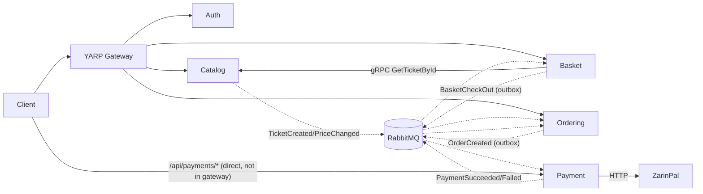

# TravelTicket - ARCHITECTURE (draft for approval)
Purpose: .NET 10 microservices passenger-ticket booking platform; portfolio/learning project (README.md:1-5). ~10.7k LOC C#, 322 .cs files (41 test files). Commits use conventional style, e.g. `feat(auth): ...`.
Style: Vertical Slice + DDD + CQRS (MediatR) + Carter minimal APIs + FluentValidation pipeline + Result<T> (BuildingBlocks/ResultLib).

## Services (src/Services/*, solution: src/TravelTicket-microservice.slnx)
- Auth (`Auth/AuthService`): ASP.NET Identity + JWT login/register/email-confirm (MailKit->Mailpit), roles SuperAdmin/Admin/User; seeds DB (`Data/SeedAuthDb.cs`).
- Catalog (`Catalog/Catalog.API`): Ticket CRUD (admin-only writes), gRPC server `Grpc/CatalogRpcService.cs`, publishes ticket events via outbox.
- Basket (`Basket/Basket.API`): per-user cart (Postgres + Redis cache), checkout publishes `BasketCheckOutIntegrationEvent`; gRPC client to Catalog.
- Ordering (`Ordering/Ordering.{API,Application,Domain,Infrastructure}`): only multi-project (Clean Arch) service; creates Order from checkout, updates status on payment events.
- Payment (`Payment/Payment.api`): creates Payment for an order, ZarinPal gateway redirect + callback verify, publishes success/failed.
- Gateway (`Gateway/WebApplication1`, csproj `Yarp.Api`): YARP reverse proxy + JWT; routes /auth /tickets /baskets /orders only.
- BuildingBlocks (`Commons/BuildingBlocks`): shared lib - CQRS ifaces, behaviors, DDD base, Outbox (Hangfire+EF), MassTransit setup, OTel/Serilog, CorrelationId, Result, paging, test base.

## Communication

Evidence: MassTransit RabbitMQ `BuildingBlocks/Messaging/Events/MassTransitExtension.cs:10-35`; consumers in `Ordering.Infrastructure/Consumers/*`, `Payment.api/Consumers/OrderPaymentRequestedConsumer.cs`, `Basket.API/EventHandlers/CatalogEvents/*`; proto `BuildingBlocks/Contracts/Protos/Catalog.proto`; gRPC wiring `BasketExtension.cs:90`.

## Infrastructure (src/docker-compose*.yml, src/.env untracked)
Postgres x5 (Catalog 5433, Basket 5434, Ordering 5435, Auth 5440, Payment 5450; one DB per service), Redis 6379 (Basket), RabbitMQ 5672/15672, Aspire dashboard 18888 (OTLP 18889), Mailpit 8025/SMTP 2525. Services: catalog 6000, basket 6003/6053, auth 6066, ordering 6080, payment 6090/6091 (container 8080). Health: `/health-<svc>`. Swagger in Development. No CI (.github is empty).

## 10 key files
1. `src/docker-compose.override.yml` - ports/env/deps
2. `src/Commons/BuildingBlocks/BuildingBlocks.csproj` - shared stack
3. `.../Messaging/Events/MassTransitExtension.cs` - broker wiring
4. `.../Infrastracture/Outbox/OutboxProcessor.cs` - outbox publisher (Hangfire job)
5. `.../EntityFramwork/Interceptors/DispatchDomainEventInterceptor.cs` - domain events via MediatR
6. `Catalog/Catalog.API/CatalogExtensions/CatalogExtension.cs` - typical service DI (copy pattern)
7. `Catalog/Catalog.API/Program.cs` - typical pipeline
8. `Basket/Basket.API/basket/BasketCheckout/BasketCheckOutCommandHandler.cs` - saga start
9. `Ordering/Ordering.Infrastructure/Consumers/BasketCheckOutEventConsumer.cs` - order creation
10. `Payment/Payment.api/Features/CallBack/PaymentEndpoints.cs` + `Services/ZarinPalGateway.cs` - payment
Also: `src/TODO.cs` (author's roadmap), `Gateway/WebApplication1/appsettings.json`.

## Oddities / risks
- Gateway not in docker-compose; its cluster addresses are hardcoded localhost:5000/5001/5279/5053 (do not match compose 6000/6003/6066/6080); no payments route.
- Payment publishes with `bus.Publish` directly (`EventHandlers/PaymentSucceededEventHandler.cs:22`) - not outbox, unlike others; its consumer swallows exceptions (no retry/DLQ).
- Hangfire dashboard open: `Authorization = []` (Catalog `Program.cs:57`); OTLP endpoint hardcoded 127.0.0.1:18889 (`Program.cs:26`).
- `AddMassTransitWithAssembly` copy-pasted 3x; `CurrentUser` duplicated in Catalog/Ordering/Payment; policy "AdminOnly" redefined per service.
- Ordering leftovers: `WeatherForecastController`; only `GET /orders/{id}` exposed. Consumer namespace `Ordering.Application.Events` lives in Infrastructure.
- Test libs (Moq, FluentAssertions, Testcontainers) referenced by prod lib BuildingBlocks.csproj.
- Path-case drift `Basket/` vs `basket/` (Linux Docker risk). Typos in dirs: `Infrastracture`, `EntityFramwork`, `AuthSerive.UnitTests`.
- README mentions `deployments/docker-compose/` which does not exist; README is mojibake-encoded.
- Passwords: `.env` is untracked (good); `appsettings*.json` not audited for secrets.
- Missing per TODO.cs: API versioning, circuit breaker, inbox/saga, clear basket after payment, delete basket-cache.

## UNKNOWN
- Root `Ordering.Domain/` folder contents/purpose (untracked/empty?). Which TestProject1 etc. actually pass; none run.
- How the JWT signing key/issuer are shared across services (config keys not read).
- Full Payment->Ordering status flow and ZarinPal sandbox config; Basket cache invalidation behavior.
- Deployment target beyond docker-compose; EF migrations apply strategy per service (`MigrateDb.cs`, `DatabaseExtensions.cs` not read).
